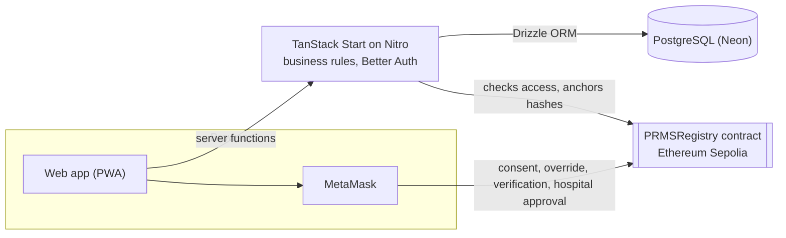

# PRMS: Patient Records Management System

A decentralised, unified electronic health record for a network of hospitals. Patients control who reads their
record through a smart contract on Ethereum, doctors see one timeline across every hospital, and a
contraindication engine blocks unsafe prescriptions using history recorded anywhere on the network.

Final-year project, Department of Computer Science, University of Ibadan.

**Smart contract (Ethereum Sepolia):** [`0x8b041dacf83b85dea2b4eddb365087682bf72929`](https://sepolia.etherscan.io/address/0x8b041dacf83b85dea2b4eddb365087682bf72929)
<!-- After deploying to Vercel, add a line here:  **Live app:** https://your-project.vercel.app -->

## Features

- **Patient consent (FR1).** Patients approve, decline and revoke doctors' access by signing in MetaMask. Consent lasts 24 hours.
- **Emergency override (FR2).** A verified doctor can open a record without consent for one hour. It is logged on the ledger and in the patient's audit log.
- **Contraindication engine (FR3).** 19 rules from the *Nigeria Standard Treatment Guidelines* (2022) check every prescription against history from all hospitals.
- **Immutable addendum (FR4).** Records are never edited or deleted. A dispute adds a linked correction and the original stays, marked disputed.
- **Laboratory workflow (FR5, FR6, FR11).** Orders issue single-use, time-limited tokens to a department, at any hospital that accepts them. Technicians see only the requisition.
- **Nursing (FR7)** and **unified timeline (FR8).** Ward lists and vital signs; one chronological record across hospitals.
- **Network administration (FR9, FR10, FR12, FR13).** The registrar admits hospitals, administrators verify staff and define departments, clinicians choose their working hospital.

Six roles: patient, doctor, nurse, laboratory technician, hospital administrator and platform registrar.

## Architecture



- **The contract decides access.** The server asks `hasAccess(patient, doctor)` on the contract before serving a record.
- **The browser is never trusted.** It sends only a transaction hash; the server reads the transaction from the chain and checks its event.
- **No clinical data on the chain**, only hashes, consent and identifiers. Records form a SHA-256 hash chain anchored on the ledger.
- **Lab results are encrypted** with AES-256-GCM under a key derived for the ordering physician. Roles are enforced on the server.

## Technology

| Layer | Technology |
|---|---|
| Web app | React 19, TanStack Start and Router, Tailwind CSS 4 (installable PWA) |
| Server and auth | TanStack Start server functions on Nitro, Better Auth |
| Database | PostgreSQL (Neon) through Drizzle ORM; embedded PGlite for local use |
| Blockchain | Solidity 0.8.24 contract, viem, MetaMask; Hardhat for the local chain |
| Tests and hosting | Vitest; Vercel |

## Getting started

You need **Node.js 24**, **pnpm 10** and the **MetaMask** extension. Local mode runs its own blockchain and
database, so no online accounts are needed.

```bash
pnpm install
cp .env.example .env    # Windows: copy .env.example .env
pnpm chain              # terminal 1: local blockchain, leave it running
pnpm bootstrap          # terminal 2: deploy the contract, create the tables, load the seed data
pnpm dev                # http://localhost:3000
```

Every seeded account uses the password **`Prms@Demo2026`**. All people and hospitals in the seed data are invented.

| Account | Role |
|---|---|
| `emeka@prms.test`, `adaeze@prms.test`, `musa@prms.test` | Patients |
| `dr_bello@prms.test`, `dr_okafor@prms.test` | Doctors |
| `nurse_ojo@prms.test` | Nurse |
| `lab_haem@prms.test` | Laboratory technician |
| `admin_a@prms.test` | Hospital administrator |
| `registrar@prms.test` | Platform registrar |

To sign actions, import that person's `privateKey` from `wallets.local.json` into MetaMask.

## Testing

```bash
pnpm test               # 55 automated tests of FR1–FR13 on a fresh local chain and database
```

The 59-case manual test plan is in [seed/TEST_SCENARIOS.md](seed/TEST_SCENARIOS.md).

## Project structure

```
contracts/     PRMSRegistry.sol smart contract
src/routes/    Pages for the six roles
src/server/    Business rules and server functions
src/lib/       Contraindication engine, wallet, auth
src/db/        Database schema
seed/          Seed data and test plan
scripts/       Deploy, seed and demonstration scripts
```

## More

- [docs/GUIDE.md](docs/GUIDE.md): MetaMask setup, the ten-minute demonstration, deployment to Sepolia, Neon and
  Vercel, all commands, and troubleshooting.
